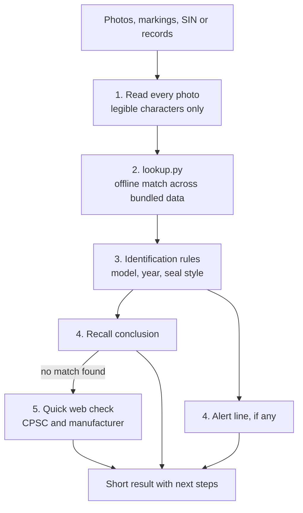

# Sprinkler Recall Checker

By Corey Kinsman. Reach me on [LinkedIn](https://www.linkedin.com/in/ckinsman/).

**Check an installed fire sprinkler against U.S. recalls and counterfeit alerts from a phone photo.**

`check-sprinkler-recalls` is a [Claude skill](https://code.claude.com/docs/en/skills) that identifies fire sprinklers from photos, readable markings, sprinkler identification numbers (SINs) or records. It then checks them against:

- **U.S. recalls and replacement warnings:** Central O-ring (wet, dry, Gem and Star branded), Omega, Star (Mealane, AHI and the SCM ME-1 warning) and Globe Model J dry.
- **Counterfeit and certification alerts:** 44 UL and FM Approvals alerts from 2007 to 2026 covering Tyco, Globe, Viking, Angus, Protector, Reliable and others. These are reported on their own line and never treated as recalls.
- **O-ring corrosion risk:** O-ring sprinklers with corrosion at the seal are flagged even when no recall covers the model.

The result is short and phone-friendly. It separates confirmed matches from uncertain identification and asks for the specific photo or record that would close the gap.

> **Disclaimer:** Personal project, not affiliated with or endorsed by any employer, manufacturer, CPSC, UL, FM Approvals or NFSA. Results are AI-generated informational screening only. They are not an inspection, engineering opinion, product authentication, code compliance determination or certification. Provided "as is" without warranty. Read [DISCLAIMER.md](DISCLAIMER.md) before use.

## Quick start

No programming is needed. Most people should use Option A. It takes about five minutes, and the skill then works in Claude chats, in Cowork and in the Claude desktop app.

> [!IMPORTANT]
> Use the file named **check-sprinkler-recalls.zip**. The green **Code** button on this page and the **Source code** zips on the release page download the whole project, and Claude will not accept them as a skill.

### Option A: Claude web or desktop app

**Step 1. Turn on code execution.** Skills only work when it is on.

1. Open Claude and go to **Settings > Capabilities** ([direct link](https://claude.ai/settings/capabilities)).
2. Turn on **Code execution and file creation**. In newer versions of Settings it is called **Create and edit files**.

On a Team or Enterprise plan, your organization owner controls this setting. If you can't find it, ask them to turn on code execution and skills.

**Step 2. Download the skill.**

1. Click [**check-sprinkler-recalls.zip**](https://github.com/trainfire/Sprinkler-Recall-Checker/releases/latest/download/check-sprinkler-recalls.zip). The download starts right away.
2. Leave the file zipped. Don't double-click it, open it or extract it.

On a Mac using Safari, check your Downloads folder. If you see a folder named `check-sprinkler-recalls` instead of a `.zip` file, Safari unzipped it for you. Go to **Safari > Settings > General**, turn off **Open "safe" files after downloading**, and download the file again. Or download it with Chrome.

**Step 3. Upload the zip in Claude.**

1. Go to **Customize > Skills** ([direct link](https://claude.ai/customize/skills)).
2. Click the **+** button, then **Create skill**.
3. Choose **Upload a skill**.
4. Select `check-sprinkler-recalls.zip` from your Downloads folder.

`check-sprinkler-recalls` now appears in your skills list. Make sure its switch is on.

Don't drag the zip into a chat. A chat only attaches the file to that conversation, and the skill is not installed.

**Step 4. Use it.**

1. Start a new chat.
2. Attach one or more sprinkler photos with the paperclip button, or drag the photos into the message box.
3. Type a request, for example:

   > Identify this sprinkler from the attached photos and check applicable U.S. recalls or replacement warnings.

You don't need to name the skill. Claude uses it whenever a request is about sprinkler recalls or counterfeit sprinklers. Some checks need web search, so leave web search on in the chat's tools menu.

**For Team and Enterprise owners:** you can add the same zip for everyone in your organization under **Organization settings > Plugins & skills**. If your organization limits network access, allow cpsc.gov, tyco-fire.com, tyco.widen.net, ul.com, japan.ul.com, code-authorities.ul.com, fmapprovals.com, approvalguide.com and prnewswire.com.

### Option B: Claude Code

If you already installed the skill in the Claude app (Option A), Claude Code signed in with the same Claude account picks it up automatically (version 2.1.273 or later). Run `/skills` to confirm it is listed.

To install it in Claude Code only:

1. **Download the skill.** Download [check-sprinkler-recalls.zip](https://github.com/trainfire/Sprinkler-Recall-Checker/releases/latest/download/check-sprinkler-recalls.zip) and unzip it. You get a folder named `check-sprinkler-recalls`.

2. **Install it.** Copy the `check-sprinkler-recalls` folder into your personal Claude skills folder:

   | System | Skills folder |
   |---|---|
   | Windows | `C:\Users\<your user name>\.claude\skills\` |
   | macOS | `/Users/<your user name>/.claude/skills/` |

   If the `skills` folder doesn't exist yet, create it. The `.claude` folder is hidden by default: in Windows File Explorer use **View → Show → Hidden items**, and in macOS Finder press **Cmd + Shift + .** to show it.

   To use it in one project only, copy the folder into `.claude/skills/` inside that project instead.

   Check that the path ends in `.claude/skills/check-sprinkler-recalls/SKILL.md`. A common mistake is one folder too many, such as `skills/check-sprinkler-recalls/check-sprinkler-recalls/SKILL.md`.

3. **Ask Claude.** Start a new session, attach the photos or type the markings, and ask your question. Claude asks permission before running the lookup script.

### Option C: Codex

Codex needs the whole repository. Click the green **Code** button, then **Download ZIP**, unzip it, and install the unzipped folder as a plugin. The Codex manifest is `.codex-plugin/plugin.json`, and `skills/check-sprinkler-recalls/agents/openai.yaml` holds the Codex interface settings.

### Troubleshooting

| What happened | What to do |
|---|---|
| The upload failed or said no skill was found | You probably downloaded the whole project with the green **Code** button or a **Source code** zip. Download [check-sprinkler-recalls.zip](https://github.com/trainfire/Sprinkler-Recall-Checker/releases/latest/download/check-sprinkler-recalls.zip) and upload that file. |
| I dropped the zip into a chat and nothing was installed | A chat only attaches files. Upload the zip in **Customize > Skills** (Step 3). |
| There is no Skills page, or skills are greyed out | Turn on code execution (Step 1). On a Team or Enterprise plan, ask your organization owner. |
| There is no **Upload a skill** option | Your organization may have turned off skills that members upload. Ask your owner to allow it or to add the skill for everyone. |
| On a Mac, the download turned into a folder | Safari unzipped it. See the Mac note in Step 2. |
| Claude doesn't seem to use the skill | Check that its switch is on in **Customize > Skills**, start a new chat, and mention a sprinkler recall or counterfeit check in your request. |
| The result says the current status was not verified | Web search is off or blocked. Turn it on, or ask your admin to allow the sites listed under Step 4. |

### Updating to a new version

1. In **Customize > Skills**, open `check-sprinkler-recalls`, click **...** and choose **Delete**.
2. Download the new `check-sprinkler-recalls.zip` and upload it as in Step 3.

New versions are listed on the [Releases](https://github.com/trainfire/Sprinkler-Recall-Checker/releases) page.

## Example prompts

- "Identify this sprinkler from the attached photos and check applicable U.S. recalls or replacement warnings."
- "Check the recall status of this sprinkler using its manufacturer, model or SIN, and manufacture date."
- "Which photos or markings do I need to tell an O-ring sprinkler from a Belleville-seal variant?"
- "Check whether this sprinkler's markings appear in any UL or FM counterfeit alerts."

Good photos make the biggest difference. Take a close, sharp shot of the deflector and the frame (wrench boss), plus one looking straight at the seal cap inside the frame. Do not remove, twist or touch an installed sprinkler or its cover plate to get a better view.

## What a result looks like

An illustrative result for a Central GB pendent with a 1999 date where the seal cap is not visible:

> **Result:** Potential recall match: Central GB in recall scope; seal style not visible.
>
> **ID:** Central GB, pendent, 1999 (tentative)
>
> **Evidence:** "GB" and "1999" legible in Photo 1. Tyco Table A lists a 1998 seal change for this model, so the date alone cannot clear it.
>
> **Next:** Take a photo looking straight up at the cap inside the frame to show whether it is flat (O-ring) or conical (Belleville).
>
> **Source:** [CPSC 01-201](https://www.cpsc.gov/Recalls/2001/cpsc-central-sprinkler-company-announce-voluntary-recall-to-replace-o-ring-fire), Tyco guide p. 13 | bundled, verified 2026-10-13
>
> *AI screening aid only. Verify with a qualified fire sprinkler professional before acting.*

A result reaches one of five conclusions:

| Conclusion | When it is used |
|---|---|
| Recall match confirmed | Every criterion in the notice is established: manufacturer, exact model or variant, construction, year and, where the notice depends on it, seal variant |
| Replacement warning confirmed | Same standard, for a warning rather than a recall (for example SCM Star ME-1 dated 1983 to 1995) |
| Potential recall/warning match | A plausible affected model with a criterion still missing; the result names what is missing |
| No matching recall or replacement warning found | Only after enough identification and a quick web check. A bounded search result, never proof of safety |
| Unable to determine | Photo unusable, manufacturer not established, or a needed check could not run |

Counterfeit alerts appear on a separate **Alert** line (suspect counterfeit features, counterfeit alert lead, or certificate alert) and never change the Result line. The skill never states that a unit is counterfeit or authentic; only the issuing body or the manufacturer can confirm that.

## How it works

Claude reads the photos; bundled references and a lookup script do the matching. Reading markings on a small, often painted or corroded part needs visual judgement, so that part is Claude's. Matching those markings against recall scopes, model tables and alert records is routine, so a script and structured data files do it the same way every time.



### 1. Reading the photos

- Every photo is labeled (Photo 1, Photo 2) and every legible character is transcribed. Uncertain characters are marked `[?]`, never guessed.
- Mirror-reversed stamps, wrench-boss text and bulb markings are read when legible.
- The year is never inferred from building age, temperature rating or bulb color, and a head is not called dry-type just because it sits on a dry-pipe system.

### 2. Offline lookup

`scripts/lookup.py` takes every legible marking and an optional year, for example `python scripts/lookup.py GLOBE GL5651 --year 2024`. It returns four sections:

| Section | What it checks |
|---|---|
| Recall register | 9 U.S. recall and warning records, with an in-scope check on the year |
| Tyco model index | 76 Central, Gem and Star model rows with seal styles, 1998 seal transitions and figure pages in the Tyco guide |
| 2009 O-ring list | Whether the model appears on the historical O-ring identification list (a construction cue, not a recall list) |
| Counterfeit alerts | UL and FM alerts that share a designation or distinctive marking, with the issuer-stated cues to look for |

Without Python, Claude reads the same JSON files directly.

### 3. Identification rules

Claude reads only the section of `references/identification-rules.md` that the candidate needs. For Central, Gem and Star models with a 1998 seal change, it compares the cap with the seal comparison image from the Tyco identification guide and, if needed, renders the figure page the lookup points to.

### 4. Deciding

The recall conclusion and the Alert line are decided separately. O-ring construction, corrosion, obsolescence, an advisory listing or a counterfeit alert alone is not a recall, and a whole brand is never declared recalled.

### 5. Web only when needed

Most results need no browsing. Before it reports "no matching recall found", the skill runs one or two quick searches (the CPSC site and the current manufacturer source), plus one UL or FM search when a counterfeit check applies. Without web search it reports "Unable to determine" instead of a negative result.

## What's included

- 9 U.S. recall and warning records with notice dates, hazards, program status and retrieval provenance
- 44 UL and FM Approvals counterfeit and falsified-certificate alerts, each with literal markings, issuer-stated external cues, supporting cues, removed-unit cues and links to the original notice
- 76-row Tyco/Central model, variant, figure and seal-style index
- Field identification rules, dated notice summaries, source provenance and known gaps
- Tyco identification guide and FAQ (PDF and searchable text) and the 2009 O-ring identification list
- 50 boundary scenarios in `references/screening-checks.json` documenting expected behavior

Recall data was reviewed 2026-10-14; counterfeit alerts were reviewed 2026-10-18 from the original notices. UL and FM alerts are cited by link; their photos are not bundled.

## Requirements

- **Web search** for the no-recall check and for comparing photos with an alert link. Everything else works offline.
- **Python / code execution** for the lookup script and PDF page rendering. Recommended; the skill falls back to reading the files directly.

## Repository layout

```
.claude-plugin/plugin.json       Claude plugin manifest
.codex-plugin/plugin.json        Codex plugin manifest
plugin.json                      Portable manifest
assets/icon.svg                  Plugin icon
skills/check-sprinkler-recalls/
  SKILL.md                       Workflow Claude follows
  scripts/lookup.py              Offline lookup across bundled references
  references/                    Recall register, counterfeit alerts, rules, model index, summaries, sources
  assets/                        Tyco PDFs, seal comparison image, 2009 O-ring list
  agents/openai.yaml             Codex interface settings
  DISCLAIMER.md, NOTICE.md, LICENSE.txt
CHANGELOG.md, DISCLAIMER.md, NOTICE.md, LICENSE
```

## Limitations

- The recall register is a U.S. starter set. It does not cover every recall, warning or advisory worldwide.
- Recalls, remedy programs and manufacturer contacts change. Check the review dates above before relying on bundled data.
- The AI model can misread photos and markings. A cover plate alone cannot identify the sprinkler behind it.
- The counterfeit-alert file is not exhaustive, and its known gaps are listed in `references/sources.md`. No match does not authenticate a product.
- The skill does not give field instructions to remove, clean, test or disassemble installed sprinklers, and it does not perform an NFPA 25 compliance assessment.

## Updates

See [CHANGELOG.md](CHANGELOG.md). New versions are published on the [Releases](https://github.com/trainfire/Sprinkler-Recall-Checker/releases) page.

## Disclaimer

Results are AI-generated screening only and must be verified against the original CPSC, manufacturer, UL and FM Approvals notices and with a qualified fire sprinkler professional before any decision is made. See [DISCLAIMER.md](DISCLAIMER.md) for the full terms and limitation of liability.

## License

MIT for the author's original content. See [LICENSE](LICENSE). Bundled third-party files remain the property of their owners and are listed in [NOTICE.md](NOTICE.md).
